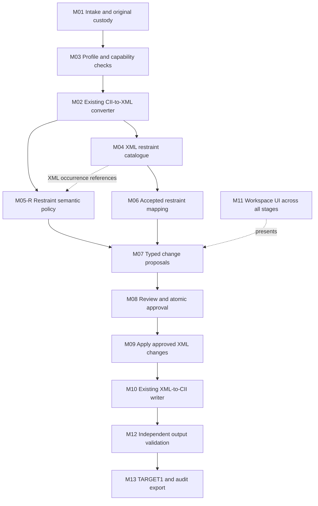

# CIIFR — XML-based property editing and transfer

**Concept note v2.0 · Draft for review · 1 November 2026 (Dubai)**

Design order: **Concept → Architecture/framework/modules → WBS → Implementation plan → Code.** All four documents in this folder are connected design drafts. No runtime implementation is authorized by publication of this package. Review the concept before adopting the downstream design.

This revises the [v1 concept](../CONCEPT_NOTE_v1.0.md), retains its two ownership paths and restraint-first priority, and replaces the proposed new direct-byte property writer with reuse of the existing XML conversion/reconstruction route. It belongs to [program WBS #227](https://github.com/reallakshman19/XML_Compare_Utilities/issues/227) and [property workstream #224](https://github.com/reallakshman19/XML_Compare_Utilities/issues/224). Architecture: [02](02_ARCHITECTURE_FRAMEWORK.md); WBS: [03](03_WBS.md); coding plan: [04](04_IMPLEMENTATION_PLAN.md).

New to the project or CII? Start with the [Oracle checkpoint and CII primer](05_ORACLE_CHECKPOINT.md), then use the [Oracle takeover prompt](06_ORACLE_TAKEOVER_PROMPT.md). These preserve the current frontier and open decisions; they do not lift the coding pause.

## 1. Purpose and intended outcome

Extend CIIFR from name replacement and read-only property evidence into an auditable engineering editing tool. An engineer should be able to load a supported CII, navigate by node or element, understand the stored data and its meaning, propose a targeted edit or SOURCE→TARGET transfer, resolve ambiguity, review the actual changes and export a validated new CII.

The central route is:

**Original CII → existing CII-to-XML converter → authoritative editable XML → node/element/property modules → approved XML changes → existing XML-to-CII writer → TARGET1.**

The property modules must be independent of CII physical serialization. They select and change represented XML fields through a common transaction interface; they do not each create a writer. This reuses the existing engineering conversion work while retaining a field-level explanation of every output change.

The application must offer a usable solution when the mapping and field semantics are qualified. Otherwise, it must explain the specific missing decision and the engineer's next action. A list of UNKNOWN findings alone is not the intended finished workflow.

## 2. Problem to solve

The reported problems expose several separate boundaries:

| Observation | Design implication |
|---|---|
| A file appears to load forever | Every intake operation needs progress, cancellation and a terminal outcome; an error elsewhere on the screen must not leave the file card pending |
| Legitimate generated CII files encounter a version/profile restriction | Admission must consider declared version and actual record structure, then use a supported converter profile; filename or a literal header match alone is insufficient |
| Many auxiliary families are labelled unqualified by the new inspector | Reader coverage, structural validity and edit eligibility need separate presentation |
| Zero-node slots contain retained direction/payload values | Inactive data must be preserved and explained; it must not become an active restraint or be cleared without qualified rules |
| A separate property writer was proposed | Consolidate serialization in the existing XML reconstruction route and keep family-specific meaning in independent modules |

Current source observations and prototype limits inform this concept. They do not establish the exact cause or format of the separately named generated file until that file is received through authorized custody. Concept development can proceed without inventing that evidence.

## 3. Scope: broad framework, phased capability

**Owner clarification, 1 November 2026: the first focus and first engineering delivery are RESTRANT.** The active design slice is CII → existing XML conversion → restraint node/occurrence → restraint edit or transfer → reviewed XML → existing writer → validated TARGET1 and audit.

Other property editing modules, including FORCMNT, are deferred. The framework retains their future extension points, but their feature delivery is not a prerequisite to the restraint slice. Existing non-restraint data must still be preserved: any physical-grammar work strictly necessary for that preservation is a reconstruction dependency, not an expansion into another editing feature.

The complete ownership spectrum below is the future catalogue; it does not dilute the first restraint delivery or require every family to be implemented first.

| Property family | Engineering owner and required context | Main hazards |
|---|---|---|
| Node names and labels | Logical node plus every physical alias/reference; labels may also belong to elements/branches | Conflicting aliases, shared storage, partial rename, width/encoding loss |
| Restraints | Attachment node plus exact occurrence, type, direction and connection; storage may be reached through an element pointer | Wrong restraint occurrence/type, CNode, nonlinear meaning, defaults, gap/friction/stiffness interpretation |
| Imposed displacements | Node/specification, component, case/set and prescribed/free state | Confusing zero with free/unspecified, wrong case or coordinate basis |
| Applied forces/moments | Node/specification, force/moment component, case/set and basis | Sign/axis/unit mistakes; confusing applied inputs with computed reactions |
| Temperature/expansion and pressure | Selected oriented element and operating-condition field | Stored versus effective/inherited meaning, wrong condition, thermal-strain interpretation |
| Fluid density and distributed weight data | Element plus relevant unit and loading context | Incorrect distributed mass/weight or inherited state |
| OD, wall thickness, corrosion allowance and section geometry | Exact selected element or explicitly selected run, with end/component context | Stiffness/strength changes, unintended diameter transitions, accidental propagation across shared nodes |
| Material and physical properties | Element/material assignment plus code/database/temperature context | Treating equal material IDs as equivalent, inconsistent modulus/density/expansion/allowables |
| Insulation, cladding and similar layers | Element-owned fields and density/weight units | Double counting, wrong dimensional basis, changed distributed weight |
| RIGID | Element-owned rigid record and its weight/type context | Treating a nearby rigid as a node property, confusing absent record with zero-valued data |
| Bends, SIF/tees, reducers and other auxiliaries | Typed record plus owner/end/intersection/node relationships | Wrong local/end convention, shared references, unqualified physical grammar or field meaning |
| Hangers, nozzles and equipment attachments | Their own record relationships and model/options context | Coupled arrays, connecting nodes, design-state and CONTROL/MISC dependencies |
| Model-wide units, axes, codes and execution settings | Model/global context | Affecting many families at once; these are separate high-impact operations |

Computed stresses, reactions and analysis results are not interchangeable with input properties. Node renumbering, geometry reconstruction, unit-system conversion, material-database changes and new/deleted structural records require separate operation definitions; they are not side effects of Find/Replace.

## 4. Two navigation paths, one XML-backed system

### A. Node → selected element → element data

A node is an entry point into a set of element occurrences. The engineer chooses the intended oriented element before changing its data. TO-only discovery is a valid convenience: enter a TO node, enumerate every matching element and choose explicitly. FROM-only or either-end discovery can be offered with the same rule.

For example, two elements ending at the same node may have different pressures. Selecting one pressure field must not alter the other element. An explicitly selected run is a different scope with its own boundary and propagation policy. Reversed FROM/TO storage is not automatically flow direction or an instruction to transform all fields.

### B. Node → selected attachment occurrence → node data

A logical node can have several restraints, displacement specifications, forces and name aliases. The engineer selects the exact attachment occurrence and its fields. An occurrence retains its owning record, typed pointer/reference, slot/specification, type, direction and connecting-node context.

Slot 2 in SOURCE does not inherently map to slot 2 in TARGET. A restraint's storage-owner element does not automatically identify its attachment node or establish cross-model equivalence. RIGID records remain element-owned even when displayed near a node.

The two paths share XML custody, catalogue, mapping, review, validation and output services. They do not flatten all data into a universal node-property row.

## 5. Editing and transfer are distinct operations

| Operation | Needed inputs | Expected behavior |
|---|---|---|
| Inspect | TARGET0; SOURCE optional | Show qualified data, ownership and retained unknowns without mutation |
| Target-only Find/Replace or explicit edit | TARGET0, selected owners/fields, field-specific rule | Propose typed changes within that declared scope; no cross-model mapping is needed |
| SOURCE→TARGET transfer | Both originals, accepted correspondence and field/case/context selections | Propose changes to qualified target XML fields using source values with proven compatible meaning |
| Structural change | Explicit structural operation and dependency rules | Create/remove/reindex only through the existing converter's separately qualified structural capabilities |

Text fields may reuse existing literal/regex selectors where appropriate. Engineering numeric edits operate on named typed fields, values, units and state; they are not a global textual replacement of matching digits. A change to restraint type, CNode or a related mask may require a coupled transaction rather than an isolated scalar assignment.

## 6. What XML must preserve

XML is the editable intermediate, not an approximate model rebuilt from a topology drawing. It needs one authoritative storage representation and derived node/element/branch views that reference it.

Preserve record identities and order, typed ownership and references, stored values, lexical/layout metadata, reserved/inactive payload and the source profile needed to reconstruct untouched content. Keep original tokens, typed values, effective values and provenance distinct. A source digest retained as provenance is not the digest of a modified output.

Three cases must remain distinguishable:

1. **Known physical grammar and qualified meaning:** inspection and approved editing can be supported.
2. **Known physical grammar but unqualified engineering meaning:** exact reconstruction/preservation may be supported; editing that meaning remains unavailable.
3. **Unknown physical grammar or unresolved dependencies:** permit clearly limited inspection where possible, but do not claim complete editable conversion or safe export through opaque replay.

The converter's reconstruction must be controlled by represented XML values. Replaying an embedded whole original CII while ignoring XML edits would not satisfy this concept. A topology-oriented UXML view is also insufficient by itself to regenerate all CII engineering data. Reuse the existing XCU UXML hub where a qualified view/adapter is needed; do not create a competing universal XML hub.

## 7. Version/profile handling and file loading

The input adapter must establish what the file declares, what its records actually contain, and which existing converter profile supports it. It should validate required sections, record layouts, counts, references, encoding and termination rules together. A supported lexical/header variant must retain its own representation; an inconsistent declaration and body must receive a specific explanation.

Do not convert V11 to V14 by editing the VERSION text. If the existing version bridge is used, retain its audit and distinguish original-file identities/addresses from those of a derived representation. Preserving the input output-profile is the recommended default; explicit version conversion is a separate visible choice.

Loading, inspection and edit/export eligibility are separate capabilities. A readable file need not be writable in every family. A file with a known-but-uninterpreted auxiliary should not look globally corrupt because the selected inspector lacks that semantic module.

Required user-visible outcomes include ready for inspection, ready for the selected edit, supported only in part, unsupported profile with a next step, failed with a reason, and cancelled. Pending work must not reinstall stale state after another selection. Large-file work must keep the UI responsive; runtime reuse and cancellation belong in the architecture review.

## 8. Correspondence and engineering context

SOURCE and TARGET0 are independent namespaces. Equal node numbers, names, element ordinals, FROM–TO pairs or pointer values do not prove identity. Candidate discovery, accepted mapping, field eligibility and approval are separate decisions.

Resolve a node map, element map or attachment-occurrence map as required by the selected operation. Preserve alternatives and conflicting targets. Parallel elements, reversed orientation, subdivision/consolidation and shared auxiliary storage need explicit policies; they cannot be resolved by first match or a high similarity score alone.

Field eligibility includes units and dimensions, coordinate basis, operating/load case, direction/end convention, prescribed/free/default state and relevant code/material context. A compatible representation is not necessarily compatible engineering meaning. The first release need not convert units or rotate vectors; it must provide actionable held cases where those capabilities are absent.

## 9. Review, output and audit

The engineer reviews actual before/proposed values, owner/occurrence, mapping reason, relevant context and the complete affected scope. Auto-eligible means a change can be proposed under qualified rules; it is not silent permission to apply it.

Approved XML changes are atomic transactions. The common edit service validates the approved field set, modifies a new TARGET XML model, regenerates derived references and invokes the existing writer. It must detect conflicting module proposals and prevent unapproved or stale XML changes from reaching output.

The audit follows:

**Original record/field → canonical XML field → node/element occurrence → accepted mapping or local rule → approved change → updated XML field → writer output → validation evidence.**

Show engineering values on the main review screen and detailed lexical/record evidence on demand. The export package can contain TARGET1 and the relevant change/audit documents; originals remain immutable. Private input bytes, paths and engineering identifiers stay in authorized custody.

## 10. Fidelity and acceptance

For an admitted exact-fidelity profile, unchanged CII→XML→CII must reproduce the original bytes. An edited output must demonstrate the intended represented changes and preserve unselected content under the declared contract. If canonicalization is ever intended, it needs an explicit different contract and visible permitted differences; it cannot masquerade as exact round trip.

Use independent expected edits, counts/references, formatting and bystander checks. Compare stored and effective meaning where the operation requires it. Test zero/default state, precision, aliases, shared pointers, duplicate owners, reversed orientation, stale approval, cancellation and failed output publication. Native application import and engineering acceptance remain distinct from byte reconstruction.

An XML conversion success, a matching no-op hash, a browser test and an engineering review prove different things. The system should report each accurately rather than granting one blanket PASS.

## 11. Reuse strategy and present evidence

The reversible typed-XML candidate is [PR206](https://github.com/reallakshman19/XML_Compare_Utilities/pull/206) at `c2452deb96b402f0dda52f63748bc795049b46bc`. It wraps a pinned existing XMLv2 storage parser/writer with XMLv3 reference views. Inspection and a bounded local probe demonstrate a byte-exact no-op and an XML-controlled logical-node name edit on the authorized V14 original.

That implementation remains a draft, bounded Python prototype. It is not yet the general browser adapter needed here. It rejects the inspected public V11 generated benchmark and has unsupported populated-section/context profiles. Those gaps must be resolved in the existing conversion ownership boundary, not through a parallel property writer or silent fallback to a generative converter.

The production engineering XML-to-CII generator, reversible typed XML and topology UXML are different representations with different fidelity contracts. Architecture selection must identify which existing modules actually meet each requirement. Reuse their qualified parser, schema, formatter, writer and validators; extend an upstream module once where necessary.

The pre-pause loader/display/probe experiments are preserved and assessed in **Appendix A**. They are reusable candidates, not adopted architecture or completed implementation.

## 12. Requirements carried into the next documents

| ID | Concept requirement |
|---|---|
| C01 | One existing XML reconstruction writer; property modules have no CII serialization responsibility |
| C02 | One authoritative typed XML storage model with derived references and preserved lexical/profile context |
| C03 | Version plus actual-structure admission; terminal, responsive and cancellable loading |
| C04 | Separate inspect, target-only edit, SOURCE→TARGET transfer and structural operations |
| C05 | Preserve node versus element ownership, orientation and individual attachment occurrences |
| C06 | Explicit correspondence and ambiguity handling; no identity from equal numbers/slots alone |
| C07 | Field-specific meaning: units, basis, cases, defaults/sentinels and relevant code/material context |
| C08 | Actionable proposals and manual-review routes, with exact affected scope |
| C09 | Approval-bound atomic XML transactions, conflict handling and stale-state revocation |
| C10 | Independently demonstrated no-op fidelity, edit causality and preservation of bystanders |
| C11 | Traceable input→XML→decision→output audit and protected private custody |
| C12 | Restraints first; extensible modules for the wider property catalogue |
| C13 | Existing tabs and workstreams stay protected during a phased migration |
| C14 | Distinguish coverage notes, structural failure, semantic eligibility and acceptance |
| C15 | Reuse parked experiments only after their assumptions are reconciled with the approved design |

## 13. Decisions and boundaries

Confirmed Owner directions are XML-mediated editing, reuse of existing writers, restraint priority, the two ownership paths, and concept/architecture/WBS/plan before code. This package proposes how to realize those directions.

Decisions to settle during design review are the existing intermediate schema/adapter contract; the first qualified input-profile set; the first restraint type/field operation set; runtime integration; output fidelity/profile policy; and the scope of staged migration. Recommended first engineering delivery is existing-record restraint editing/transfer with explicit mapping and qualified context. New records, unit/basis conversion and all-family support remain later capabilities rather than hidden assumptions.

The [architecture](02_ARCHITECTURE_FRAMEWORK.md) derives modules from C01–C15; the [WBS](03_WBS.md) assigns dependency-ordered deliverables; the [implementation plan](04_IMPLEMENTATION_PLAN.md) defines future work packages and acceptance. Publication of these drafts starts no coding, agent assignment, merge or release.

## 14. CIIFR · WBS process map

**Status snapshot: 1 November 2026. Current gate: Concept and Appendix A review.** D1 Concept, D2 Architecture, D3 WBS and D4 Implementation plan are submitted drafts; downstream details remain provisional. Coding is paused. Existing R0 inspection is merged, but the new XML-based engineering workflow is not implemented. Existing components and parked experiments below are reuse inputs, not completed new framework modules. This is a dated map, not a live progress display.

The diagram shows the proposed restraint-first data flow. WP01 establishes the capability/fixture baseline; WP02 qualifies the existing converter. WP05 semantic evidence may begin after WP02 and consumes WP03 XML occurrence references before its results join WP04 at WP06.

M11 is cross-cutting, not an additional step after export. The M02/M10 gateways reuse the selected existing conversion/reconstruction implementation; the diagram does not introduce another writer.

| Module | Where we are now | Planned restraint-first work | WBS |
|---|---|---|---|
| M01 Intake/custody | R0 intake exists; terminal-status, timeout and stale-read fixes are parked | Adapt custody/progress/cancellation to the selected XML adapter; every intake reaches a truthful terminal state | WP01, WP03 |
| M02 CII→XML | Existing XMLv3 is a bounded draft prototype; the browser adapter is not built | Qualify restraint-bearing input profiles and invoke the existing converter with complete preservation evidence | WP01, WP02 |
| M03 Profiles/capabilities | R0 exposes partial coverage and UNKNOWN notes | Distinguish file/profile validity, preserved data and selected restraint-edit eligibility; reuse grouped evidence presentation | WP01, WP02, WP05 |
| M04 XML references | Prototype views cover element endpoints and names; the restraint catalogue is missing | Resolve restraint nodes, exact occurrences, storage owners, shared references and CNode context from XML | WP03 |
| M05-R Restraint module | No XML-backed restraint editing/transfer module is implemented | Qualify type/field/unit/state/direction/connection rules and actionable held cases; this is the first engineering family | WP05, WP07 |
| M06 Mapping | R0 lookup does not establish accepted SOURCE→TARGET identity | Explicit node and restraint-occurrence pairing, including CNode relations and conflicting alternatives | WP04 |
| M07 Proposals | Typed XML restraint comparison/proposals are not built | Show actual before/proposed values, affected owners and incompatible/conflicting claims | WP06 |
| M08 Review/session | Existing tab approvals belong to their current flows; new property transactions are not built | Bind atomic approvals to current XML/files/mapping/context; adapt parked stale-work guards | WP06 |
| M09 XML application | A bounded name-edit probe exists; the approved restraint-change service is not built | Modify a new TARGET XML model only at approved restraint fields and regenerate qualified derived references | WP06 |
| M10 XML→CII | Existing reconstruction writer is a limited prototype dependency, not Property UI integration | Reuse that writer with reviewed XML/profile; preserve unrelated data and reject unsupported reconstruction | WP02, WP06 |
| M11 Workspace | Merged Property tab is an R0 read-only inspector | Connect node/occurrence selection, restraint review/manual resolution and the new-copy workflow | WP03, WP07, WP10 |
| M12 Validation | Historical R0 and parked experiment evidence exists; it does not qualify the new workflow | Independently check restraint edit causality, protected bystanders, references/state, stale output and relevant native acceptance | WP02, WP06, WP10 |
| M13 Audit/export | XML property TARGET1 export is not implemented | Export only the validated new CII with actual output identity and input→XML→decision→output trace | WP06, WP07, WP10 |

**First delivery path:** WP01 → WP02 → WP03; WP04 and WP05 join at WP06 → WP07 restraint delivery → WP10 scoped qualification. **Deferred:** WP08 other editing families, including FORCMNT, and separately scoped WP09 structural operations. Other populated data must still be preserved as part of the admitted input's reconstruction contract.

## 15. How to use it

The [detailed restraint-first implementation plan](04_IMPLEMENTATION_PLAN.md#12-detailed-restraint-first-implementation) expands this map and usage sequence into data contracts, mapping decisions, field policy, transaction state, implementation packages and acceptance cases. It remains a plan, not product code or approval to start coding.

### 15.1 Use the design and process map

1. Review the concept and Appendix A first: intended restraint outcome, existing-writer reuse, fidelity and reusable experiments.
2. Read the architecture for each M-module's responsibility; use the table above to distinguish existing parts from missing XML integration.
3. Follow the WBS dependencies and implementation plan to define the smallest useful restraint delivery. A prototype or historical test result is not completion of a later module.
4. Resolve the first input-profile and restraint-operation sets before coding. Keep other editing families deferred and document only necessary preservation dependencies.

### 15.2 How its restraint mapping works

This is the proposed XML-backed restraint resolution/mapping logic, not a claim of current implementation.

| Layer | Mapping rule | Required distinction |
|---|---|---|
| Document/local node | Resolve a numeric node within its own input/XML document | Equal SOURCE and TARGET node numbers do not prove identity |
| Physical storage → XML | The existing converter resolves the owning element's typed RESTRANT reference into its canonical XML record/fields | Pointer value is a section-local reference, not a node number or cross-model ID |
| Record → occurrence | Enumerate each restraint occurrence with its attachment node, type, direction, CNode, slot and owners | A block may contain several restraints; slot order is local and slot is not a universal DOF label |
| Node view → canonical fields | The node catalogue references the authoritative XML fields and retains sharing/owner context | Do not duplicate writable values, clone shared records or require the attachment node to equal a storage-owner endpoint |
| SOURCE → TARGET | Accept the intended node pair and exact compatible restraint-occurrence pair; resolve connecting-node relationships where applicable | Matching names, types, slots or pointer numbers alone is insufficient |
| Field eligibility | Check selected operation, type-dependent meaning, units, state/defaults, direction/basis and target representation | Storage validity does not prove engineering edit eligibility |
| Approved change → output | Apply approved typed values to TARGET XML, then call the existing reconstruction writer and validate its output | Property modules do not splice CII bytes or copy whole source blocks |

Illustratively, SOURCE node 500/slot 2 could pair with TARGET node 850/slot 5 after the node/occurrence/context decisions are accepted. SOURCE's pointer or slot integer is not copied into TARGET. For a local TARGET-only edit, no SOURCE map is needed; the selected target occurrence and qualified rule still have to be explicit. These identifiers are examples, not observations from a private model.

### 15.3 Planned engineer workflow

1. Load TARGET0 and, for transfer mode, SOURCE through the qualified existing CII→XML route. Retain immutable originals and distinguish conversion/inspection readiness from edit readiness.
2. Select the target logical node and display all its restraint occurrences, including type/direction/CNode, exact record/slot and owner evidence.
3. Select the intended occurrence and fields. For transfer, explicitly pair the source occurrence and resolve the required node/CNode correspondence.
4. Choose a qualified typed edit/Find–Replace rule or source value. Show missing semantics, context or mapping as a specific actionable review need.
5. Review before/proposed values, affected-owner scope, XML field references and transaction membership. Inactive/reserved payload remains preserved and is not automatically activated or cleared.
6. Approve and validate the complete transaction. A changed file, XML model, mapping or relevant context revokes stale decisions/output.
7. Apply to a new TARGET XML model, reconstruct through the existing writer, independently validate the intended restraint changes and untouched bystanders, and export TARGET1 plus audit.

This is the planned user journey. The current merged Property tab remains an inspector; this section is not an instruction that those editing/export controls already exist.

### 15.4 How we should use PR246

PR246 is a later FORCMNT reference, as recorded in Appendix A5. Its useful principles are canonical field/record references, typed values alongside original lexical data, complete owner inventories, XML-only reconstruction and independent provenance comparison. Assess those principles for the RESTRANT design through the existing converter's restraint support.

Do not use its FORCMNT record shape, field slots, fixed benchmark pin or unresolved force-field meanings as restraint rules. Do not treat internal XML hashes as authentication of original ownership or as SOURCE→TARGET correspondence. Any reuse must retain original-source witnesses and approval-bound expected changes. FORCMNT feature integration remains deferred; PR246 is not the first restraint milestone or a mandatory new dependency.

## Appendix A — reuse plan for parked experiments

### A1. Preservation and status

Owner explicitly requested reuse planning rather than discarding the experimental work. The frozen [reference archive](reference/PARKED_EXPERIMENTS_20261101.zip) and [member register](reference/EXPERIMENT_REGISTER.json) preserve the actual pre-pause candidate bytes and sanitized evidence. The archive is not installed, imported, served or approved as product code by this design package. It must be extracted only into an isolated reference directory.

- Experimental baseline: `3051ea171f966ac611f232982e0b1cc0774ba368`.
- Archive: 25,694 bytes; SHA-256 `d6c696d8db81ff47b205ca09045cd73b4125f7eac2843e51dca543e117e43b04`.
- No implementation commit, repair PR, merge or deployment was made before the design pause; the experimental remote branch was created at the baseline only.
- Archive contents exclude original CII, derived private XML, private digests, raw private model ledgers and screenshots. The existing XML engine is referenced by its pinned source, not vendored into this archive.

### A2. Asset-by-asset disposition

| Asset | What it already addresses | Planned reuse | What must change or be requalified |
|---|---|---|---|
| File-card terminal status and progress | Parse/I/O/profile/hash failure can leave the card at Loading | Adapt into M01 intake/session UX and M11 workspace controller | Status must describe the selected XML/profile pipeline, not hard-code V14-only readiness |
| Request-generation guards | Older async success/failure can replace a newer file selection | Retain the cancellation/staleness pattern in M01/M08 | Bind conversion, XML catalogue, mapping and validation jobs too; an async timeout alone cannot preempt synchronous work |
| Read/hash deadlines | An actual pending file or digest operation needs a terminal outcome | Reuse the bounded-operation idea and retry behavior | Choose limits from supported runtime/model sizes; qualify worker cancellation and UI responsiveness rather than treating 30 seconds as a universal rule |
| Immutable loaded-byte custody | The old panel retained only an index/hash | Retain originals alongside authoritative XML and distinct current/output fingerprints | Use one central custody service; modules must not mutate the bytes or reconstruct from DOM text |
| Grouped UNKNOWN evidence display | Repeated coverage/residue notes overwhelm the workflow | Adapt the grouped expandable presentation into M03 capability/coverage UX | Preserve meaningful errors, severity and selection impact; do not promote UNKNOWN to legal/invalid or hide affected-operation blockers |
| Seven new intake/display regressions | Terminal status, malformed/read failure, valid bytes, stale rejection, clear during read, timeout/retry and grouped evidence | Reuse the scenarios in WP01/WP03 qualification | Preserve the terminal-state requirement; replace V14-only rejection assumptions only when a newly qualified profile actually supports that input |
| Native 132/132 VNext and 9/9 Geometry logs | Evidence for the exact parked local experiment and old-tab protection | Retain as a historical comparison baseline | They do not qualify a later XML adapter, altered candidate, browser or engineering writer; run applicable checks on the later actual head |
| XML reuse probe | Existing XML-only no-op and logical-node name edit with independent physical expectations | Reuse as a checker in WP02; expand with approved family-specific cases | It is a probe, not a serializer or transfer engine. A25 names and the pinned V14 profile are not universal formatting rules |
| Changed-reference and V11-negative probes | Dependency identity must be verified; unsupported input must not be silently admitted | Retain as profile/dependency falsifiers | New supported profiles need positive expectations plus adversarial counterparts; an old rejection is not a permanent product requirement |
| Source/served mirrors | Existing app delivery depends on matching module pairs | Reuse parity verification after the architecture selects deployment paths | Do not spread or install archived files merely to obtain parity |
| Proposed direct-byte property writer entry | An earlier scope proposed a second admission path into the raw-byte writer | **Do not adopt this writer design** | Replace it with XML change application plus the existing reconstruction writer; retain only relevant ownership/approval invariants |

M01/M03/M08/M11 and WP references are proposed downstream design identifiers, defined in documents 02 and 04; they are not implemented modules or dispatched tasks.

### A3. Adoption sequence

1. Review the concept and architecture; decide the existing XML adapter, custody and capability contracts.
2. Verify archive/member identities and compare each candidate against the current source and active work.
3. Classify each asset as retain, adapt, evidence-only or reject; record the reason in the relevant work package.
4. Reuse the smallest useful part. Retain the terminal-state and stale-work scenarios, while replacing the old V14-only indexing seam with the selected XML conversion adapter.
5. Apply applicable qualification to the actual later candidate, including old-tab behavior, supported profiles and independent expected XML/CII edits. Distinguish a passed test transport from engineering acceptance.

### A4. What the experiments do not establish

They do not establish the exact Owner-generated file's format, broad V11 support, a browser-connected XML workflow, restraint field semantics, SOURCE→TARGET correspondence, structural record editing, licensed CAESAR acceptance or release approval. The actual generated file and other representative profile fixtures belong in later capability/qualification work, not as a reason to skip the current design sequence.

### A5. PR246 — later-family reference, not the first delivery

[PR246](https://github.com/reallakshman19/XML_Compare_Utilities/pull/246) at `e29ef4679b0f06f1a2864e075afb046a26965671` is a bounded FORCMNT section qualifier. Its lexical-field, ownership-reference and independent-provenance techniques may inform assessment of existing converter support. It is not a SOURCE→TARGET matcher, a restraint codec or a first-delivery gate. Its FORCMNT 20-row/110-field layout and pinned benchmark must not be substituted for RESTRANT grammar or meaning.

FORCMNT feature integration belongs to deferred WP08. If a restraint-bearing input contains FORCMNT data, preserve that data through the qualified existing conversion route; evaluate any necessary preservation support within WP02 without adding force editing or delaying restraints for a general FORCMNT module. The immediate reuse/design assessment follows RESTRANT records and restraint transactions.
