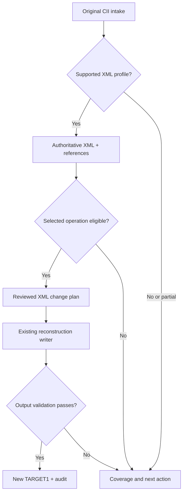

# CIIFR — architecture, framework and module responsibilities

**v2.0 · Provisional design derived from the draft concept · 1 November 2026**

Read [01 Concept](01_CONCEPT_NOTE.md) first. This design is not a coding instruction or an adopted schema. The [WBS](03_WBS.md) and [implementation plan](04_IMPLEMENTATION_PLAN.md) depend on its reviewed boundaries. Existing runtime/writer dependencies remain unchanged.

## 1. Architectural decision

Use one authoritative editable XML model behind independent property modules, and one existing XML reconstruction writer. Keep CII physical grammar, formatting and reconstruction in the existing conversion ownership boundary. Property modules resolve XML references and produce typed, auditable intent.

Reuse of a module is conditional on its demonstrated contract. A schema named XML, a generative XML-to-CII exporter and a lossless reconstruction writer are not interchangeable. The first design task is a capability assessment of the existing modules, not writing a new common model or serializer.

An output failure preserves the originals and revokes the candidate output. Inspection can remain available where its own contract is valid.

## 2. Reuse boundaries and XML authority

The inspected reversible candidate is PR206 at `c2452deb96b402f0dda52f63748bc795049b46bc`, wrapping the pinned XMLv2 parser/writer. Its `Storage` contains authoritative typed fields and lexical metadata; `EngineeringViews` references those fields. The current Node view covers endpoints and name occurrences; engineering attachment views need a qualified extension.

Architecture review must assess this candidate alongside the existing version bridge, engineering XML generator, field catalogues and XCU UXML adapters. The recommended direction is to extend the existing reversible conversion boundary where evidence permits, retaining one authoritative field set. Do not introduce a competing XML schema or topology hub merely because a convenient feature is absent.

Topology/UXML can supply a qualified view or correspondence evidence. A topology graph does not become the complete writable CII model. Original storage references, inactive records and lexical metadata remain necessary for reconstruction and audit.

Where existing upstream grammar is incomplete, record the capability gap and qualify a focused upstream extension. An alternate per-property parser/writer is outside this architecture.

## 3. Module catalogue

Identifiers below are responsibility labels, not newly implemented source files or new agent assignments.

| Module | Owns | Inputs → outputs | Explicit boundary |
|---|---|---|---|
| **M01 Intake and custody** | Original immutable bytes, fingerprints, job identity, progress/cancellation | Selected file → original custody record and completed/partial/failed intake state | Does not guess engineering values or rewrite headers |
| **M02 Existing conversion gateway** | Calling qualified existing CII↔XML converters/bridges and retaining provenance | Original + declared profile → validated existing XML representation and conversion evidence | No parallel parser, serializer or hidden fallback |
| **M03 Profile/capability catalogue** | Supported physical grammar, versions, families, contexts and operations; coverage presentation | Converter/field evidence → read/round-trip/edit capability and specific blockers | File readability and a particular field's edit eligibility remain distinct |
| **M04 XML ownership/reference catalogue** | Logical nodes, exact elements, attachment occurrences, aliases and shared-owner graph | XML Storage + existing view builders → reference-only navigation indexes | Does not duplicate authoritative values or infer cross-file identity |
| **M05 Property family modules** | Family-specific selection, semantics, eligibility and expected changes | XML refs + context + selected operation → qualified field intent or actionable review need | No raw CII parsing/writing; no direct file download |
| **M06 Scope and correspondence** | Target selection and accepted SOURCE→TARGET node/element/occurrence maps | Candidate evidence + engineer decisions → explicit mapping/scope ledger | Equal numbers, names, slots or proximity are discovery evidence, not automatic approval |
| **M07 Comparison and proposals** | Before/proposed values, compatibility, conflict discovery and transaction proposals | Field intent + mapping/context → complete proposal set | Does not modify XML or grant its own approval |
| **M08 Review and transaction session** | Decisions, atomic groups, current fingerprints and stale-work revocation | Proposals + user review → current approved transactions | Changing dependencies revokes affected output; navigation alone does not corrupt independent tabs |
| **M09 XML change application** | Applying exactly approved intent to a new XML model and qualified dependency updates | TARGET XML + approved transactions → edited XML and field-change ledger | Reuses existing XML validation/view/dependency routines; no byte mutation bypass |
| **M10 Existing reconstruction gateway** | Invoking the single selected existing writer with the reviewed XML/profile | Validated edited XML → candidate CII + writer result | Property plugins cannot substitute another writer |
| **M11 Workspace/UI controller** | Two-path navigation, family screens and actionable review flow | Service state → visible engineering choices, progress and evidence | Uses services; DOM cells are not serialization input |
| **M12 Validation** | Independent intent/postimage checks, original immutability and profile consistency | Original/edited XML, approved changes, candidate CII → bounded validation result | Parser success alone is not engineering acceptance |
| **M13 Audit/export** | Complete trace, actual TARGET1 identity and new-copy publication | Validated candidate + approval/validation evidence → TARGET1 and selected audit artifacts | No stale reconstruction at download time; no original overwrite or automatic private upload |

M01/M02/M03 form intake; M04/M05/M06 form engineering resolution; M07–M10 form controlled editing; M11 presents the workflow; M12/M13 establish and publish the bounded result.

## 4. Property modules under M05

| Submodule | Initial and later responsibilities | Context it must declare |
|---|---|---|
| M05-R Restraints | First engineering module; individual occurrence comparison/edit/transfer | Node/type/direction/CNode, nonlinear interpretation, units/defaults, tags/identity and affected storage owners |
| M05-N Names and labels | Logical-node name closure and scoped element/branch labels; reuse existing qualified selectors | Alias/shared-field ownership, text width/encoding and label identity |
| M05-P Process | Selected element temperature/expansion, pressure, density and hydro/condition fields | Stored/effective meaning, operating-set mapping, units and inheritance |
| M05-D Displacements | Input prescribed motions by node/specification/component/set | Basis, units, prescribed/free/unspecified state |
| M05-F Forces/moments | Applied input vectors and load-set alignment | Force versus moment dimension, sign, basis and case |
| M05-E Element physical data | Section geometry, materials, insulation/cladding, rigid properties | Element/end ownership, code/material identity and weight/stiffness consequences |
| M05-A Other auxiliaries | Bends, SIF/tees, reducers, hangers, nozzles and equipment | Typed references, special states and qualified dependencies |

Every module exposes the same conceptual responsibilities: identify relevant XML fields; report supported operations/context; assess eligibility; compare or propose typed intent; state expected postconditions; explain held/manual cases. They may be developed separately after the design is accepted. Their independence comes from explicit contracts, not separate copies of CII grammar.

## 5. Shared conceptual records

Use existing schema structures where they satisfy these responsibilities; do not freeze a new implementation schema before the capability assessment.

| Record | Required information |
|---|---|
| Original custody | Document identity, actual byte fingerprint/length, detected encoding/version/profile, immutable original and job generation |
| XML custody | Current XML identity/fingerprint, schema/profile, converter implementation identity, original provenance and validity/coverage state |
| Canonical field reference | Document-scoped storage record/field key, typed value/state, original lexical/layout metadata, units/context and original/derived source link |
| Ownership reference | Node or element/endpoint, attachment occurrence, owners, typed record/ref, slot/specification, direction/connection and sharing |
| Mapping decision | Source/target reference sets, cardinality, evidence/alternatives, accepted decision, revision and context assumptions |
| Change intent | Operation kind, selected field refs, exact before/proposed typed values, dependencies, affected-owner closure and reason |
| Transaction decision | Atomic membership, approved IDs, current source/target/XML/mapping/profile fingerprints and review provenance |
| Validation result | Specific claim checked, actual input/candidate identity, independent expectation, PASS/FAIL/NOT_RUN and residual limits |
| Output/audit | Actual TARGET1 identity, committed XML change ledger, preserved/held items and relevant engineering/import disposition |

An ordinal is a local address. A pointer belongs to a typed family. A view reference is not an editable duplicate value. Original and derived-version byte positions must be labelled separately.

## 6. Operation flows

### Target-only edit

Intake TARGET0 → obtain qualified XML → select node/element/occurrence and fields → evaluate a field-specific Find/Replace/edit rule → propose changes → review → apply to new XML → reconstruct through the existing writer → validate → export.

No SOURCE mapping is invented for this mode. A node-name operation follows all qualified alias occurrences of that logical node. A numeric operation addresses named engineering fields and qualified state, not arbitrary matching tokens.

### SOURCE→TARGET transfer

Intake both documents independently → build reference catalogues → accept the mapping required by the selected family → qualify fields/cases/units/basis → compare/propose → review atomic changes → apply only to TARGET XML → existing writer → validation/export. SOURCE stays immutable.

### Structural operation

Select an explicitly supported create/delete/reindex operation → calculate the complete dependency impact → review affected record identities, counts, pointers and arrays → use existing qualified structural conversion routines → independently validate output. This is a separate later capability; selecting an empty attachment slot does not implicitly enable it.

## 7. First restraint workflow

Show all restraints at a selected logical node with type/direction/connection, storage occurrence and owners. In transfer mode, pair source and target occurrences explicitly; different slot or pointer numbers are expected possibilities.

Family-specific eligibility establishes the meaning of each selected field, including type-dependent payloads, connecting-node mapping, direction/basis, units and defaults. The first admitted operation set is chosen from the capability/fixture assessment; the earlier X/Y/Z-ground-only idea remains a candidate, not an assumed complete product boundary.

The UI distinguishes editable existing records, unresolved mappings, unsupported semantic operations and structural requests such as a missing target attachment. Each held row identifies the dependency and next action. A manual decision cannot bypass unrepresentable output or unknown field meaning.

## 8. Loading and capability state

The controller must distinguish no file, pending work, completed inspection, selected-edit readiness, partial support, unsupported profile, failure and cancellation. Failure of a later stage must update both the owning file card and overall workflow state.

Jobs carry document/generation identity through read, conversion, indexing, mapping, validation and export preparation. Old completion must be ignored after a new selection. Cancellation needs a real runtime strategy for long parsing/conversion work; Promise timeouts alone do not preempt synchronous execution.

Reuse the current runtime/provider where qualified. Assess browser Python/worker integration, dependency loading, memory/model-size bounds and cancellation in the architecture-to-plan handoff. Do not quietly introduce a server, upload private models or change deployment/runtime selection.

Capability states describe the selected task. Known physical grammar with unknown engineering meaning may be preserved without becoming editable. Unknown grammar or a dependency that cannot be preserved blocks affected output. Grouped evidence remains accessible; actual structural failures remain prominent.

## 9. Transaction and dependency rules

- Apply a complete approved transaction to a new XML model. Detect overlapping/conflicting proposals from different property modules; no last-writer-wins policy.
- Recheck original and XML identities, mapping/scope revisions, profile/context and before values at Apply and Export, not only when the UI proposes changes.
- Regenerate derived XML references through the existing view routines when represented values affect names/issues/views.
- Recalculate length/count/pointer/material-vector dependencies only through qualified existing rules and only where the operation permits it. A value-only change normally preserves those structures.
- Make shared storage impact visible. Approve the complete owner closure or hold the operation; do not silently clone a record to make an edit appear local.
- Preserve inactive payload and untouched lexical data. Property modules cannot erase it as cleanup.

## 10. Validation and audit separation

M12 verifies that the approved XML changes are complete and exclusive, that the writer applied them, and that unselected data and structural invariants remain preserved. Use independent literal/analytical/field expectations appropriate to each profile and operation. A no-op comparison and an edited-output comparison are both needed.

M13 retains the input→XML→decision→output trace, actual output identity and held/rejected items. Publication is a separate new-copy step after validation. Private engineering data stays local or in the approved private route; public records contain permitted sanitized evidence.

Native application import and independent engineering review are later acceptance dimensions. The XML writer's success is not a claim that selected support values or a material substitution are appropriate for a real model.

## 11. Migration and protection

Keep the existing top-level tabs and their owning state intact. Introduce the XML-backed Property services behind their own boundary. Existing Normal/Nodal/Line+Node/Geometry functions remain protected until a separately reviewed migration adopts the XML services for those flows.

Avoid a big-bang replacement. First qualify conversion and a selected engineering operation, then expand family/profile coverage. Maintain source/served parity according to the accepted deployment layout. Any shared-shell change needs demonstrated necessity and regression coverage.

## 12. Requirement-to-module trace

| Concept requirements | Principal modules |
|---|---|
| C01–C02 | M02, M04, M09, M10 |
| C03, C14 | M01, M02, M03, M11 |
| C04–C06 | M04, M05, M06, M07 |
| C07–C08, C12 | M03, M05, M06, M07, M11 |
| C09 | M08, M09, M10, M13 |
| C10 | M02, M10, M12 |
| C11 | M01, M04, M08, M12, M13 |
| C13 | M08, M11 plus migration validation |
| C15 | M01, M03, M08, M11/M12; concept Appendix A |

Open design questions are existing converter/schema fit, qualified profile set, first restraint operations, runtime integration and output-profile policy. The [WBS](03_WBS.md) separates those decisions from implementation; the [plan](04_IMPLEMENTATION_PLAN.md) must not treat them as resolved merely because these module labels exist.
