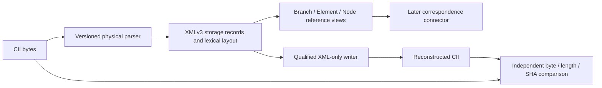

# CIIFR XMLv3 — concept and fidelity contract

26 October 2026, Asia/Dubai. Status: SOURCE-GROUNDED DESIGN; converter not implemented/qualified by this document. Task: WIP-CIIFR-XMLV3-01a1746f.

## Owner outcome

Convert actual CAESAR II CII into useful, structured XMLv3 and reconstruct CII from that XML alone. For every accepted unchanged input, require zero differing bytes, equal byte length and independently computed equal SHA-256. The XML must expose engineering fields and relationships; an embedded original file or a cache-dependent replay does not satisfy the requirement.

The requested browsing/connector hierarchy is Branch (stored Line Number) -> Elements -> Nodes. Element data exposes process/elemental properties; node data exposes source-qualified nodal properties such as Node Name. This hierarchy will later connect correspondence results to data. Geometry matching, property transfer and Target_enriched.CII are downstream consumers, not part of this first converter slice.

## One model, two linked views

The physical CII model is not a tree of independent branches. Nodes and auxiliary records can be shared; some values belong to an element end, a shared record or the model. Therefore use one authoritative storage field per source occurrence and reference it from engineering views.



Storage contains ordered sections, records, rows and typed fields, plus their exact spelling, padding, encoding and terminators. Engineering views contain identities, field references, ownership, endpoint roles and unresolved/conflicting evidence. Views do not duplicate writable values. Model settings, units, material assignments and shared auxiliaries retain their real storage ownership outside the branch tree.

Illustrative proposed XML, not an accepted schema or customer fixture:

```xml
<CiiXmlV3 schema="3.0" profile="qualified-profile-id">
  <Storage>
    <Section id="S-elements" name="ELEMENTS">
      <Record id="E1" index="1">
        <Field id="E1-OD" name="outside_diameter" kind="decimal"
               value="168.3" width="13" edited="false"/>
        <!-- Actual schema also requires the exact field lexeme and row layout. -->
      </Record>
    </Section>
  </Storage>
  <EngineeringViews>
    <Branches><Branch id="L1"><ElementRef ref="E1"/></Branch></Branches>
    <Elements><Element ref="E1">
      <Data><FieldRef ref="E1-OD"/></Data>
      <Endpoint role="FROM" nodeRef="N1"/>
      <Endpoint role="TO" nodeRef="N2"/>
    </Element></Elements>
    <Nodes><Node id="N1"><Data/></Node><Node id="N2"><Data/></Node></Nodes>
  </EngineeringViews>
</CiiXmlV3>
```

A repeated Line Number is a declared label grouping, not proof of connected topology or an approved branch identity. Use model-scoped node identities and retain every source occurrence. A shared node may appear under several element connectors without acquiring several independent values. Node Name ownership must retain its actual NODENAME/pointer/endpoint evidence; conflicting aliases are visible, not silently merged.

## Three separate acceptance claims

| Claim | Required evidence |
|---|---|
| Unchanged conversion is byte-exact | Original vs XML-only reconstruction: byte comparison, length and SHA all equal; writer has no original/sidecar/network dependency |
| Represented values control output | One independently specified field edit reaches exactly its allowed output span; conflicting value/lexeme or duplicate representations reject |
| Engineering interpretation is correct | Field-specific ownership, units, cases, sentinel/inheritance and reference meaning qualified against actual source/vendor evidence; native import and Owner acceptance recorded separately |

An edited CII intentionally differs from its original; its expected changed spans, values, dependent counts and new digest must be checked. Equal SHA is the unchanged-round-trip criterion, not a criterion for a successful edit.

## Reuse decision grounded in actual drafts

- [XMLv2 prototype PR157](https://github.com/reallakshman19/XML_Compare_Utilities/pull/157), head `a67487023bcafc13d68b62dbfc9bb74c61b3c64c`, explicitly preserves an unfinished HOLD snapshot. Its Python engine already stores individual fields/lexemes and reconstructs XML-only; it is the relevant candidate foundation, subject to requalification.
- The local XMLv2 engine SHA is `b2bb8ed87440e46f72833424cacd82e6605c47f372f146deec749ad2bb0ee264`. Its manifest's engine SHA differs, and the local copy lacks the live draft's HOLD notice. Preserve both identities; do not call the local package verified against that draft.
- [R4 PR163](https://github.com/reallakshman19/XML_Compare_Utilities/pull/163), head `9da244e7670a21d963def16543679a6d983d5ba7`, offers related hierarchy/source-slot work. Inspect its actual dependency before reuse; its name does not establish XMLv2 ancestry.
- [E1 PR168](https://github.com/reallakshman19/XML_Compare_Utilities/pull/168), head `2aeaf7372de66eda3bc082b8d81bf8db43c34f4b`, is a separate JavaScript read-only catalogue. Its bounded F1/F2/all-15 pointer acceptance remains useful evidence, but it is not an XMLv2 converter or XMLv3 writer.

Decision: SALVAGE_PARTIAL. Reuse inspected algorithms/contracts and retained tests after pinning actual bytes and completing engineering takeover qualification. Preserve existing XMLv2, P2/P2.1 and Geometry owners; create an isolated XMLv3 scope using the existing Python runtime and qualified writer foundation.

## First runnable result

On one explicitly supported, authorized fixture: CII -> XMLv3 -> CII, with the original unavailable during reconstruction; report zero byte differences, equal lengths/SHA, and navigable Branch/Element/Node references. Then separately change one qualified diameter field and compare with a literal independently specified 13-byte replacement. No transfer, pointer creation, element insertion or Geometry rewrite in this first card.

See [architecture and CII syntax](ARCHITECTURE_AND_CII_SYNTAX.md) and [WBS/prototype/reuse plan](WBS_AND_XMLV2_REUSE_PLAN.md). Current evidence does not establish a successful XMLv3 round trip.
