# CII Source→Target multi-family transfer — capability and certification contract v1 (DRAFT)

**Related:** Parent #69 [ARCH-01 rev 1](https://github.com/reallakshman19/XML_Compare_Utilities/issues/69#issuecomment-6164439111); semantic owner issue #50; [A0 snapshot](./cii-architecture-baseline-2026-10-14.md).

**Owner scope:** Node Name is **first** integrated family, not the whole architecture. Provision for restraints and element `PRESSURE 1` (`P1`) is **PROVISIONAL / NOT FULL CODE**. This document is an interface/architecture specification, **not executable source or release authority**. Existing Writer1A/1B/1C/2 and frozen V11↔V14 code remain unchanged.

## Goals and boundaries

- One physical correspondence truth for SOURCE members S1/S2/S3 against an immutable TARGET.
- One read-only normalized typed-delta ledger, with extensible **family-specific** identity, cardinality, unit and physical byte custody.
- One deterministic explicit mutation and scope certification layer governing existing specialized writer implementations.
- Preserve all existing family-specific safety constraints and independent byte validation. **No generic mutation writer.**
- Provisional adapters may expose differences and blockers, **not** `PREVIEW_READY`, `APPLY`, writer dispatch or non-read-only side effects.
- BM-001 lexical list and TEXPECTED partial postimage are independent reconciliation oracles. They are not physical pairing authorities.

### Logical dependencies

```mermaid
flowchart LR
  In["Frozen physical intake"] --> Graph["Canonical NODE/ELEMENT/path graph"]
  Graph --> Ev["Additive method/manual evidence ledger"]
  Ev --> Resolver["Joint constrained correspondence resolver"]
  Resolver --> Cert["Certified correspondence graph"]
  Cert --> Delta["Family delta adapters (read-only)"]
  Delta --> Policy["Versioned family capability + policy registry"]
  Policy --> Prop["Typed mutation proposals"]
  Prop --> Tx["Conflict/dependency transaction plan"]
  Tx --> Scope["Explicit write-scope certificate"]
  Scope --> Writers["Existing specialized writer routines"]
  Writers --> Oracle["Independent byte / semantic validators"]
  Bench["BM-001 / partial TEXPECTED"] -. "audit only" .-> Oracle
```



## Stage 1: physically identified entity model

All identities are namespace-qualified: `(SOURCE_MEMBER_ID, SOURCE_INPUT_SHA, ENTITY_KIND, PHYSICAL_ENTITY_ID)` or `(TARGET_INPUT_SHA, ENTITY_KIND, PHYSICAL_ENTITY_ID)`, never numeric NODE ID alone.

Entity kinds include `NODE`, `ELEMENT`, `ELEMENT_PATH`, `NODE_ATTACHED_RECORD`, `ELEMENT_ATTACHED_RECORD` and `BLOCK_RECORD`. A 1:many mapped TARGET path is represented as a relation to an **ordered set of actual TARGET segments**, not imaginary independent element matches.

`CorrespondenceCertificate.v1` (conceptual required fields):
- `certificateId`, `snapshotId`, `sourceEntityRef`, `targetEntityOrPathRef`, `entityKind`;
- `status`: `CERTIFIED | REVIEW_REQUIRED | CONFLICT | UNMAPPED`;
- `evidenceDigest`, `methods[]` (`METHOD_A | METHOD_B | MANUAL | PATH`), `alternativeClaims[]`, `constraintResults`, `unresolvedDependencies[]`;
- `reviewState` **separate** from certification; manual LOCK records the Owner assertion without discarding automatic competing hypotheses;
- `custodyProof` (source endpoint, target endpoint, region and cross-member claims, subdivision internal-node reservation where relevant).

A correspondence certificate does **not** grant any family writer permission.

## Stage 2: typed delta ledger

`TransferDelta.v1`:
- `deltaId`, `snapshotId`, `correspondenceCertificateId`, `familyKey`, `propertyKey`, `entityKind`, `sourceEntityRef`, `targetEntityOrPathRef`;
- `sourceValue`, `targetValue`, `valueType` (`STRING | NUMBER | VECTOR | RECORD | RECORD_SET`), `unitCode` or explicit unit-provenance, `loadCase`, `tolerancePolicyId`;
- `beforeTargetFieldCustody` (section/block/row/slot/record/pointer/physical span; normalized and original basis), `targetCardinality`, `sourceCardinality`;
- `deltaState`: `UNCHANGED | CHANGED | SOURCE_ONLY | TARGET_ONLY | AMBIGUOUS | UNCOMPARABLE`, `limitationCodes[]`;
- `evidenceReferences[]` and immutable provenance; **no `scopeDecision`, `APPLY` or write permission in a delta**.

Family-specific adapters add specialized typed fields but cannot redefine the shared identity namespace or overwrite evidence. Unknown family/property `UNCOMPARABLE`, never implicitly copied.

## Stage 3: versioned family capability registry

Each `TransferFamilyCapability.v1` must declare:

| Contract field | Interpretation |
|---|---|
| `familyKey/propertyKeys/entityKinds` | Canonical typed family and legal physical owners |
| `parserAndBridgeCustody` | Exact SOURCE/TARGET capability, neutral version and original byte provenance |
| `requiredIdentityProof` | NODE vs ELEMENT/PATH vs attached-record pairing requirements |
| `cardinalityPolicy` | 1:1, 1:many, slot-preserving, record create/delete/compaction; default DENY |
| `comparisonPolicy` | Value normalization, precision, units/load-case semantics and tolerance |
| `supportedActions` | Distinguish `KEEP`, `REPLACE`, `CREATE`, `DELETE`; unsupported DENY |
| `byteCustodyPolicy` | Exact record/field span, pointers, compatibility, before-value preconditions |
| `writerAdapter` | Existing specialized writer entry point only when admitted |
| `independentValidator` | Expected exact field/section/byte and structural correctness controls |
| `lifecycleState` | `CATALOG_ONLY | OBSERVATION_ONLY | SHADOW_PLAN | WRITE_ADMITTED` |
| `policyVersion/hash` | Pinned decision rules; changes invalidate any downstream certificate |
| `dependencies/conflicts` | Other properties, records, node/element custody, byte-span overlap |

**Fail-closed transition invariant:** `CATALOG_ONLY` and `OBSERVATION_ONLY` always return `WRITE_FAMILY_NOT_ADMITTED`, even if correspondence is certified and a SOURCE/TARGET value differs. `SHADOW_PLAN` may produce non-executable proposed operations for tests; it can never create a scope `APPLY` or call a writer. `WRITE_ADMITTED` requires separate Owner acceptance, exact tests, field-specific validation and no contradiction with existing writer permissions. Registering a new family does **not** automatically elevate its lifecycle state.

## Stage 4: family profiles and counterexamples

### NODE_NAME (first integration)

- Entity: certified `NODE` and exact TARGET NodeName field.
- Source/target nonblank different → `REPLACE` using existing Writer1C exact field-write policy.
- Source nonblank, target blank → `CREATE` via existing Writer2 cardinality/relocation policy.
- Source blank, target nonblank → `DELETE` only with independently qualified Writer2 policy.
- Exact same field → `KEEP`.
- Preserve source-member namespace, target field identity, node conflict veto, original hash, manual decision ledger, exact raw and normalized bytes and difference provenance.
- Classify all 28 historical current potential operations by actual action and proof before calling any `WRITER2_CANDIDATE` count true. No production changes until shadow and independent retained benchmark pass.

### RESTRAINT (extension provision, no expanded writer capability)

- Entity: NODE-attached physical restraint `RECORD_SET`, with identified record/slot and pointer custody. NODE identity alone is **insufficient**.
- Required evidence: certified host NODE; record count and slot pairing; source/target support type/code; direction and coordinate frame orientation; gap/friction/stiffness, auxiliary fields, exact physical pointer and fixed slots; optional dimension/engineering change review.
- Distinguish actions: existing-slot `REPLACE`; missing/excess records requiring `CREATE`/`DELETE`/compaction; unchanged `KEEP`. One matched NODE may have many restraint records and independently disputed pairings.
- Current code inventory: `cii-workspace-restraint-transfer.js`, `cii-workspace-restraint-pairing.js`, `cii-workspace-writer2-composite-routing.js`, Writer1B slot handling, Writer2 restraint-delete compaction and create blocker. **Do not** turn previously blocked CREATE into transferable just because the new registry exists.
- Initial lifecycle state in this *new multisource integration*: `OBSERVATION_ONLY`; derive read-only `RESTRAINT` changes and precise `RESTRAINT_RECORD_PAIRING_REQUIRED`, `RESTRAINT_DIRECTION_FRAME_NOT_QUALIFIED`, `RESTRAINT_CARDINALITY_POLICY_NOT_ADMITTED` as needed.
- Admission to any new multi-source writer route requires separate detailed restraint-specific review; pre-existing qualifying legacy writer routes are unchanged.

### ELEMENT_PROCESS.P1 — PRESSURE 1 (provisional only; no new writes)

- Entity: certified `ELEMENT` or an explicitly certified ordered `ELEMENT_PATH`.
- Value kind: physical numeric field with exact original source/target unit and load-case semantics, precision, blank/zero distinction and before-value custody.
- Existing module `cii-workspace-transfer-policy.js::writerProcess` maps P1 to *Writer1A cardinality-preserving element fixed-field* conditional policy; this architecture must not dismantle that proven narrow path.
- Initial lifecycle state for **new multi-source P1 adapter**: `OBSERVATION_ONLY`. UI may display `SOURCE P1 / TARGET P1 / DIFFERENCE / UNIT / IDENTITY BASIS / BLOCKER`, with no binding or writer invocation.
- A SOURCE PIPE corresponding to multiple TARGET PIPEs **does not** automatically authorize copying the single SOURCE P1 value to all targets. It requires a future approved explicit `ELEMENT_PATH_PRESSURE_DISTRIBUTION` policy, evidence on case semantics, segment equivalence, cardinality and overlap; default blocker `PATH_CARDINALITY_POLICY_NOT_ADMITTED`.
- P1 `0` and `blank` must retain distinct native CII meanings where format semantics distinguish them; no implicit unit conversion or pressure-case reassignment without separately specified policy.
- No generic copy, no Writer2 execution, no P1 fixture-specific exception, no processing of ambiguous element paths as if certified.

### Other extension points

`ELEMENT_PROCESS.P2..P9`, `T1..T9`, `WALL`, `OD`, `SIF_TEE`, `HANGER`, `RIGID_COMPONENT` must be cataloged with distinct physical owner and restrictions; **do not** collapse them into `PROCESS` one-click transfer. They can be admitted in later independent packages, not under A1.

## Stage 5: mutation and transaction authority

`MutationProposal.v1` is derived **only** from certified correspondence + qualified delta + matching `WRITE_ADMITTED` family capability. Mandatory fields: `proposalId`, `snapshotId`, `deltaId`, `familyCapabilityId`, `evidenceDigest`, `targetPhysicalFieldKey`, `before`, `proposed`, `operation`, `writerAdapterId`, `validatorId`, `preconditions[]`, `dependencyIds[]`, `conflictIds[]`, `scopeState`. Provisional deltas can have a **non-executable shadow observation**, never a MutationProposal eligible for binding.

The canonical **physical write key** is TARGET input hash + physical block/section identity + exact slot/record/field address + normalized action + before/after. Two independent SOURCEs offering identical values are corroborations **only after** compatible physical shared-custody certification. Different values, actions, sibling slots, or overlapping byte spans are conflicts unless specifically proved disjoint. An identical `before/after` string alone cannot resolve a physical-node identity conflict.

The transaction planner forms a dependency DAG across properties/families. Byte-preserving field edits may share a transaction only after non-overlap proof. Cardinality-changing restraint/NodeName changes may invalidate addresses/pointers for other families; after relocation, recalculate new TARGET custody and rebind subsequent edits against that hash. Never apply stale offsets. Preserve unrelated byte sections unchanged.

`WriteScopeCertificate.v1`: `sourceSetSha256`, `originalTargetSha256`, `normalizedTargetSha256`, `policyVersionDigest`, `graphCertificateDigest`, `candidateIds`, `appliedOperationIds`, `excludedOperationIds`, `targetFieldKeys`, `nonInterferenceProof`, `dependencyClosureProof`, `reviewLedgerDigest`, `scopeId`; signed off by explicit Owner review and independent validator. Any change to graph, review, hash, policy, selected family or related target field invalidates scope. Whole-source READY and provably **closed** partial scopes are distinct admission policies; **do not enable partial mode by removing aggregate blockers**.

## Example conceptual registry row (not source code)

```json
{
  "schema": "TransferFamilyCapability.v1",
  "familyKey": "ELEMENT_PROCESS",
  "propertyKeys": ["P1"],
  "entityKinds": ["ELEMENT", "ELEMENT_PATH"],
  "lifecycleState": "OBSERVATION_ONLY",
  "requiredIdentityProof": "CERTIFIED_ELEMENT_OR_EXPLICIT_PATH",
  "cardinalityPolicy": "DENY_UNLESS_ONE_TO_ONE",
  "supportedActions": ["KEEP"],
  "writerAdapter": null,
  "independentValidator": null,
  "policyVersion": "provisional-1",
  "failureCode": "WRITE_FAMILY_NOT_ADMITTED"
}
```

This is deliberately **not** a replacement for the existing narrow Writer1A P1 policy: it declares the proposed **new multi-source adapter's** permissions only.

## Invariants and admission test plan

**Contracts first:** schema determinism, no key alias collisions, no numeric node ID without SOURCE namespace, stale snapshot/hash/policy rejection, unknown family denied, provisional P1/restraint always non-writing; immutable evidence ledger; no double-counting different row populations.

**Graph:** manual + automatic additive evidence; wrong LOCK produces conflict witness rather than silent remapping; no independent name-string identity promotion; qualified subdivision as ordered path; branch symmetry remains ambiguous; cross-source TARGET custody arbitration.

**Per-family:** NODE_NAME: existing 35 REPLACE + 1 CREATE partial oracle, 0 DELETE as known-positive minimum; compare exact physical field set not count alone. RESTRAINT: 1 host NODE with 2 records, one reordered pair, direction-frame ambiguity, absent slot, create/delete/compaction distinction; no unauthorized mutation. P1: one-to-one same load case, different numeric value, blank vs zero, incompatible pressure units, SOURCE 1→TARGET 2 path, target segment conflict, missing original P1 row pointer; all provisional outcomes must block new write route.

**Cross-family:** same NODE_NAME and P1 proposed against disjoint exact bytes; restraint deletion that shifts subsequent field pointers; one SOURCE claims 2 target segments conflicting with another SOURCE; duplicate corroboration vs multi-family byte collision. All known unsafe cases fail closed with the **first physical cause** and separately derived downstream blockers.

**Native and browser:** exact fixed-source/target fixture digests, retained baseline auto+manual+mixed configurations, independent V11↔V14 bridges, source-bound CSV/JSON audit, cancellation, UI review/actual bound-scope controls and byte invariance of unrelated sections; verify correspondence and transfer logic before enabling any new writer route.

## Implementation sequence and owner admission

- **A0** baseline and actual retained input reproduction.
- **A1** versioned contracts and `OBSERVATION_ONLY` family registry examples, with schema-only negative tests.
- **A2** additive constrained correspondence resolver (independent Method A/B/path/manual evidence).
- **A3** NodeName shadow adapter + RESTRAINT/P1 read-only adapters and typed planner.
- **A4** verified scope/transaction planner with explicit source/target custody and independent byte validator.
- **A5** shadow differential vs current exact retained fixtures; full P1/RESTRAINT *read-only* evidence and no extra output writes.
- **A6** controlled production authority cutover for qualified NodeName only; independently approve each additional family later.

**Required before execution:** Owner-approved work-specific v3.6 AIM label/plan for canonical issue decomposition and child evidence, actual GitHub exact-head/fixture/CI evidence, and separate Owner authorization to change writer production gates. All current work is documentation and observational proof only.
